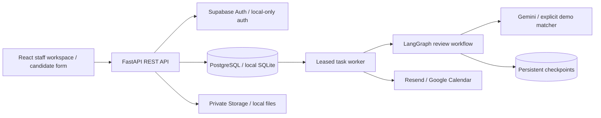

# Architecture

Hireline is a modular monolith with a client-rendered React UI. FastAPI owns authentication,
authorization, all business operations, and provider calls. A single background thread processes one
durable task at a time. This is intentionally small enough for a free demonstration deployment.

## Ownership and data model

- A candidate owns a professional profile and document references. An application joins a candidate
  to a job and stores its pipeline stage. Candidate/job pairs are unique.
- Job criteria and candidate profiles have versions. A screening references both versions and stores
  evidence, match judgments, deterministic score, and human review. Changes make older results stale.
- Each screening exposes its originating engine/model. Approved-result caching includes that identity;
  seeded demo results cannot satisfy a Gemini screening request. Explicit rescreening creates a new
  review while duplicate requests for pending work share the same task.
- Assessments own approved questions, answer keys, answers, MCQ scores, advisory feedback, and
  availability. Only the invitation hash is stored on the assessment. Email payloads containing a link
  are encrypted while queued and cleared after dispatch; saved receipts exclude the raw link.
- Interviews and outbound actions store approval identity, stable action IDs, provider receipts, and
  delivery state. Audit events record human decisions separately from model recommendations.

## AI and scoring

PDF pages and DOCX paragraphs receive stable segment labels. Extraction is bounded by file size,
page count, expanded DOCX size, and text length. Empty/scanned and password-protected documents
produce correction instructions rather than guessed content.

Gemini returns validated structured data. The deterministic demo parser/matcher is explicitly labelled
and makes no model-quality claims. Contact fields are extracted locally and omitted from scoring
prompts. All uploaded/entered content must be fictional; redaction is not a permission to upload real CVs.

Every supported/partial claim requires at least one exact source quote. Invalid references contribute
zero. Weighted factors are supported=1, partial=0.5, insufficient=0; the UI also shows missing evidence.
Verbatim validation cannot prove that a quote supports the interpretation. Recruiter review remains
necessary. Assessment performance stays separate, and no model automatically moves a pipeline stage.

## Durable processing

The task queue owns dispatch, retries, leases, and error state. LangGraph owns screening state and
the review interrupt. They do not compete to orchestrate the same work. The graph contains no email
or calendar side effects. SQLite checkpoints support the local demo; PostgreSQL checkpoints support
deployment. A new process reconstructs the graph using the persisted thread ID.

Completed parsing results are cached with input/provider/version identity. Transient failures have
bounded retries; configuration errors and exhausted free quotas remain visible. Interrupted leases
become eligible again. Hosting sleep delays work; it does not turn in-memory tasks into a scheduler.

For outbound email, the action is committed before dispatch. A timeout after possible delivery is
reconciliation-required, not an invitation to resend. Calendar event IDs derive from action IDs; the
adapter looks for an existing event before checking availability and creating a new one. This prevents
the previously created event from blocking its own retry.

## Access boundaries

- Anonymous users receive only committed synthetic fixture projections.
- Staff endpoints verify a bearer token and consult stored roles. Managers see assigned jobs only.
- Candidate tokens grant access only to one assessment and availability form, expire in seven days,
  and permit one atomic submission. Correct answers, rubrics, profiles, and staff notes stay private.
- Service-role keys and provider credentials stay server-side. Files are never served from an open
  static directory. Storage uses backend-authenticated downloads or short-lived private signed URLs.
- Actual email recipients are replaced with the owned test inbox. Calendar attendees are checked
  against owned-account configuration at the final provider boundary.

Authentication in production requires asymmetric Supabase JWT verification, PostgreSQL, private
Storage configuration, and a strong stable application secret. The local password login is rejected
in production. Public signup and arbitrary external recipients are outside this application.
